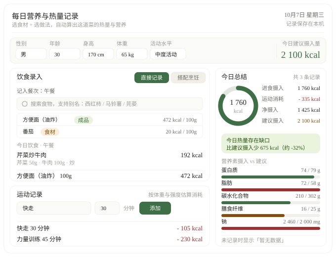

# 「每日营养与热量记录网页」需求分析文档

| 项目   | 内容                             |
| ---- | ------------------------------ |
| 项目名称 | 每日营养与热量记录网页                    |
| 文档版本 | v1.0                           |
| 编写日期 | 2026-10-07                     |
| 文档用途 | 说明本阶段（首个可交付版本）要做什么、做到什么程度、怎么验收 |
| 当前产出 | 一个网页，双击即可打开使用，无需注册、无需联网        |

## 一、项目背景与要解决的问题

**背景**

想吃得健康，第一步是知道自己到底吃了多少、动了多少。但现实中很少有人能坚持记录：一顿家常菜的食材有好几样，做法不同热量差得远，记完一堆数字还得自己算总量、算差值。结果是"想记录"的人多，"能坚持记录"的人少。

**要解决的问题（按重要性排序）**

| 序号 | 问题               | 具体表现                                                |
| -- | ---------------- | --------------------------------------------------- |
| P1 | 食材不等于吃进去的东西      | 大家很少直接吃生食材，芹菜和牛肉是"炒"在一起吃的。只记单个食材，算不出这道菜真实的油、糖、盐与热量  |
| P2 | 同一食材，做法不同热量差一半以上 | 100g 生鸡胸肉约 133 kcal，裹粉油炸后能到 250 kcal 以上。做法必须成为记录的一步 |
| P3 | 很多入口的食物拆不开       | 方便面、螺蛳粉、汉堡、奶茶没法"选食材 + 选做法"，需要能直接记录                  |
| P4 | 叫法不统一，搜不到就等于没有   | 用户习惯说"西红柿""马铃薯""芫荽""泡面"，与规范名称不一致时搜不到，就会放弃记录         |
| P5 | 只给数字不给结论         | 记录的价值在于"今天摄入是否超标、营养是否均衡、还差多少"，而不是一堆孤立数字             |
| P6 | 没记录不能被当成 0       | 信息缺失时用 0 或虚构值顶替，会让用户误判自己的摄入情况                       |

**解决思路**：选食材 + 选做法 → 自动算出这道菜的热量与营养；成品食物直接搜、直接记；当天所有饮食与运动自动汇总，并与个人建议摄入量对比，给出"盈余 / 缺口 / 基本平衡"的明确结论。

## 二、主要使用者

| 使用者          | 典型特征            | 主要诉求                    |
| ------------ | --------------- | ----------------------- |
| 普通成年人（主要使用者） | 关注体重和健康，没有营养学背景 | 记下今天吃了什么、动了多少，一眼看出有没有超标 |
| 减脂 / 控糖人群    | 对热量、碳水、钠比较敏感    | 能精确到克，能按自己实际用油改数值       |
| 学生、上班族       | 记录时间零碎，常在手机上随手记 | 步骤少，一个关键词就能搜到食物（含别称）    |

**使用环境**：电脑或手机浏览器直接打开，不需要安装、不需要注册账号。使用者不关心数据存在哪里，只关心"记了不丢、刷新还在"。

## 三、一个核心使用场景

小张，28 岁，体重 65kg，日常工作以久坐为主，想控制体重但不想天天查成分表。

| 步骤 | 他的操作                       | 页面反馈                                                             |
| -- | -------------------------- | ---------------------------------------------------------------- |
| 1  | 打开网页，填性别、年龄、身高、体重、日常活动水平   | 算出他今天的建议摄入量约 2 100 kcal                                          |
| 2  | 搜索"芹菜"加入 50g，搜索"牛肉"加入 100g | 两种食材进入待烹饪清单，克数可改                                                 |
| 3  | 选择做法"炒"                    | 自动生成菜名「芹菜炒牛肉」，给出这道菜的热量与蛋白质、脂肪、碳水、膳食纤维、钠；默认用油 6g，他按实际改成 5g，数值实时重算 |
| 4  | 点击"加入今日记录"并归入午餐            | 午餐列表出现该菜，右侧摄入热量与营养素进度同步更新                                        |
| 5  | 晚上添加"快走 30 分钟"             | 按他的体重估算消耗约 105 kcal                                              |
| 6  | 查看今日总结                     | 看到摄入 / 消耗 / 净摄入 / 建议摄入四项数值、热量平衡结论，以及五项营养素的达标情况                   |

## 四、主要功能与本阶段范围

### 4.1 主要功能

| 编号 | 功能         | 说明                                                                   |
| -- | ---------- | -------------------------------------------------------------------- |
| F1 | 个人信息与建议摄入量 | 性别、年龄、身高、体重、日常活动水平；据此估算当天建议摄入量                                       |
| F2 | 食物检索       | 名称、别称、分类三种方式都能命中                                                     |
| F3 | 直接记录       | 成品菜、速食、饮品、水果等，搜到即可计入                                                 |
| F4 | 搭配烹饪       | 多食材 + 做法组合。9 种做法：生食、凉拌、蒸、煮/炖、炒、煎、炸、烤、红烧/糖醋。默认用油、加糖、加盐按食材总量自动估算，可手动改写 |
| F5 | 菜名自动生成     | 按中式命名习惯拼菜名，如「芹菜炒牛肉」；单食材显示「鸡胸肉（蒸）」                                    |
| F6 | 运动记录与消耗估算  | 26 项常见运动，按体重与运动强度估算消耗                                                |
| F7 | 今日总结与对比    | 摄入热量进度、摄入 / 消耗 / 净摄入 / 建议摄入、热量平衡结论、五项营养素对比与状态标签                      |
| F8 | 记录管理       | 按餐次分组；记录可编辑（改食材、克数、做法）、可删除，数值随之更新                                    |
| F9 | 数据保存       | 记录保存在本机，刷新或关闭后重新打开仍在                                                 |

### 4.2 本阶段范围

**本阶段做**：F1–F9 全部功能；食物数据 218 条（全部带别称）、做法 9 种、运动 26 项、营养素指标 5 项（蛋白质、脂肪、碳水化合物、膳食纤维、钠）；电脑与手机浏览器自适应。

**本阶段不做**（明确排除，避免范围失控）：

- 账号体系、云端同步、多设备共享；
- 扫包装条形码识别商品；
- 多天历史记录与趋势图；
- 社交、打卡分享、排行榜；
- 医疗或营养处方类建议（结果仅作健康参考）。

## 五、首页需要展示的信息

首页即记录页，目标是一屏之内完成"录入 → 看结果"。

| 区域    | 需要展示的信息                                                                                                                        |
| ----- | ------------------------------------------------------------------------------------------------------------------------------ |
| 页头    | 页面名称；当天日期与星期；"记录保存在本机"的提示                                                                                                      |
| 个人信息条 | 性别、年龄、身高、体重、日常活动水平；今日建议摄入量                                                                                                     |
| 饮食录入区 | 餐次选择；两个入口「直接记录」「搭配烹饪」；搜索框与结果下拉（显示食物名、别称、分类、是成品还是食材、每 100g 热量）；已记录条目按餐次分组，显示菜名、食材与克数、做法、热量，可编辑可删除                               |
| 运动录入区 | 运动项目、时长、添加按钮；已记录运动列表及各自消耗                                                                                                      |
| 今日总结区 | 摄入热量进度环；进食摄入、运动消耗、净摄入、建议摄入四项数值；热量平衡结论（盈余 / 缺口 / 基本平衡，含差值与百分比）；蛋白质、脂肪、碳水化合物、膳食纤维、钠五项的实际值、建议值、进度条与状态标签（达标 / 不足 / 超标）；调味（油、糖）估算说明 |
| 缺省状态  | 尚无任何记录时显示「暂无数据」及引导文案；个人信息不完整时建议摄入量显示「—」；搜索无结果时提示"没有找到"，并给出可尝试的别称                                                               |

## 六、可验证需求

| 编号 | 需求                                                             | 验证方法                |
| -- | -------------------------------------------------------------- | ------------------- |
| R1 | 用户点击「搭配烹饪」后，页面由「直接记录」切换到食材 + 做法的录入面板                           | 点击后观察面板切换，已录入内容不被清空 |
| R2 | 添加「芹菜 50g + 牛肉 100g」并选择做法「炒」，页面自动生成菜名「芹菜炒牛肉」，并给出这道菜的热量与五项营养素数值 | 按上述步骤操作，核对页面输出      |
| R3 | 同一食材在不同做法下热量明显不同：鸡胸肉 150g 选「蒸」与选「炸」，两次结果差值不低于 80 kcal          | 分别记录两条，对比结果         |
| R4 | 用别称能搜到同一种食物：输入"西红柿"能搜到番茄，输入"马铃薯""洋芋"能搜到土豆，输入"芫荽"能搜到香菜          | 在搜索框逐个输入别称验证        |
| R5 | 个人信息不完整时（如未填体重），今日建议摄入量显示「—」，不显示 0，也不给出热量平衡结论                  | 清空体重后查看总结区          |
| R6 | 当天没有任何饮食与运动记录时，总结区显示「暂无数据」及引导文案，不用 0 或虚构数值代替                   | 清空当日记录后查看           |
| R7 | 记录可修改、可删除：修改某条的食物克数或做法后，该条热量与总结区数值同步更新；删除后该条同时从列表与汇总中消失        | 编辑、删除后核对数值变化        |
| R8 | 用无法识别的关键词（如"马拉糕"）搜索时，页面显示"没有找到"，不返回不相关条目，也不写入记录                | 输入无效关键词验证           |
| R9 | 刷新页面后，个人信息、饮食记录、运动记录均保留                                        | 记录后刷新页面核对           |

## 七、首页草图

版式结构说明：

1. **页头**：页面名称 / 当天日期 / 数据保存位置提示；
2. **个人信息条**：性别·年龄·身高·体重·活动水平 ｜ 今日建议摄入量；
3. **左列（录入）**：上为饮食录入（「直接记录」「搭配烹饪」两个入口 → 餐次 → 搜索 → 今日饮食列表），下为运动记录（项目 + 时长 + 添加 → 今日运动列表）；
4. **右列（结果·今日总结）**：摄入热量进度环、四项热量数值、热量平衡结论、五项营养素对比、缺省态提示。

## 八、成员分工

| 姓名   | 分工   | 具体职责                                         | 交付物         |
| ---- | ---- | -------------------------------------------- | ----------- |
| sf   | 收集信息 | 收集食物营养数据与别称、做法用油 / 用糖 / 用盐系数、运动消耗数据，整理食物分类清单 | 食物与运动数据表    |
| hzx  | 制作网页 | 实现页面：检索与录入、搭配烹饪与做法计算、结果汇总与对比、记录保存            | 可运行的记录网页    |
| hlsy | 核查结果 | 按第六节 R1–R9 逐条验收，抽查数据与计算结果，检查缺省态与异常场景         | 核查记录（见第九节）  |
| lhj  | 汇总统一 | 统一文档与页面文案口径，汇总各方产出，核对"需求—实现—验收"三者是否一致        | 需求分析文档、最终版本 |

**协作顺序**：沙枫收集信息 → 胡智宣制作网页 → 黄林司宇核查结果 → 李浩嘉汇总统一。每项分工都对应第六节中可验证的需求编号。

## 九、检查记录

以下三条由核查人逐条实测后记录，检查对象为已交付的网页。

| # | 检查动作                                   | 预期结果                                        | 实际结果                                                                                  |
| - | -------------------------------------- | ------------------------------------------- | ------------------------------------------------------------------------------------- |
| 1 | 在「搭配烹饪」中添加芹菜 50g、牛肉 100g，做法选「炒」，查看预览结果 | 自动生成菜名「芹菜炒牛肉」，并给出这道菜的热量与五项营养素数值             | 菜名显示「芹菜炒牛肉」；热量 192 kcal，蛋白质 20.8g、脂肪 10.3g、碳水化合物 4.3g、钠 727mg，五项营养素均已输出。与预期一致         |
| 2 | 在搜索框依次输入「西红柿」「马铃薯」「芫荽」                 | 分别命中番茄、土豆、香菜，并显示各自的别称                       | 三项全部命中：番茄（别称 西红柿）、土豆（别称 马铃薯 / 洋芋）、香菜（别称 芫荽）。与预期一致                                     |
| 3 | 清空当天全部饮食与运动记录，查看今日总结区                  | 显示「暂无数据」及引导文案，不出现 0 或虚构数值；建议摄入量仍按已填个人信息正常显示 | 总结区显示引导文案，四项热量数值与营养素进度条均置空，未用 0 或虚构值顶替；建议摄入量正常显示。实质与预期一致，仅文案字面为「开始记录…」而非「暂无数据」，记为待统一项 |
